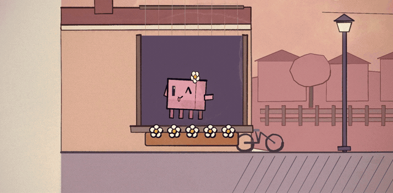

# music-mv-skill

给 Claude Code 一张角色图、一首歌和一份歌词，做一支手绘 MV。

我用它给王心凌《爱你》做了下面这支动画，又把准备素材、同步歌词和本地渲染的流程整理成了一个可以重复调用的 Skill。

*由本项目工作流制作的实际片段。网页预览无声，裁去了歌词区；完整展示版约 53.5 秒，包含结尾彩蛋。*

## 它是怎么做出来的

在 Claude Code 中输入：

~~~text
/music-mv 角色="D:/mv/character.png" 歌曲="D:/mv/song.mp3" 歌词="D:/mv/song.lrc" 截取="00:39-01:07" 风格="水彩墨线、甜蜜小镇"
~~~

Claude 先看角色、读歌词，再安排故事、绘制角色表演和转场。画面通过 p5.js + p5.brush 在本地逐帧渲染，最后与截取的音轨合成为 MP4。

**没有调用外部视频生成模型。** Claude Code 本身仍然需要模型服务；这不是免费、零 token 或几秒出片的工具。

## 我整理了哪些部分

- **一个入口**：角色图、歌曲、LRC、截取范围、画风放在同一条指令里。
- **准确截取**：按指定的源歌曲时间取片段，换算片段内的歌词时间，不自动挪到小节起点。
- **歌词承接**：处理从半句开始、片尾截断、LRC 整体偏移和多时间标签。
- **音乐节奏**：估计 BPM 与片段内的拍点，供角色动作和镜头使用。
- **Windows 流程**：中文路径、项目内缓存、显式 Chrome 路径和可恢复的逐帧渲染。
- **成片检查**：核对音轨、时长、尺寸、帧率、帧数，并尝试完整解码。

手绘引擎来自 [painted-animation](https://github.com/tuzhechen2005/opus-video-skills/tree/main/skills/painted-animation) 和 [ClaudeAnimationBase](https://github.com/JohnHeibel/ClaudeAnimationBase)。我做的是围绕音乐 MV 的调用和工程流程封装，原作者与许可保留在仓库中。

## 安装

1. [下载仓库 ZIP](https://github.com/JohnsonZhangCN/music-mv-skill/archive/refs/heads/main.zip)，解压。
2. 把其中的 **skills/music-mv 整个文件夹**放到你自己的项目 <code>.claude/skills/</code> 下面。
3. 从这个项目打开或重新打开 Claude Code，输入 <code>/music-mv</code>。

安装后应是：

~~~text
你的项目/
  .claude/
    skills/
      music-mv/
        SKILL.md
        scripts/
        references/
        assets/
~~~

**运行环境**：Claude Code、Node.js、Python 3.10+、ffmpeg/ffprobe、Chrome/Chromium。节拍检测还需要 numpy。依赖安装和浏览器设置见 [Windows 使用说明](docs/windows-setup.md)。

目前验证环境为 Windows + NVIDIA GPU；其他系统保留了原引擎的相关选项，尚未完整实测。

## 常用写法

只让一位角色做主角：

~~~text
/music-mv 角色="D:/mv/character.png" 歌曲="D:/mv/song.mp3" 歌词="D:/mv/song.lrc" 截取="00:39-01:07" 风格="小镇姑娘" 角色模式=仅橙色主角
~~~

只看分镜：在命令末尾加 <code>模式=先看分镜</code>。

少做预览：在命令末尾加：

> 直接制作完整 MV，不做独立 demo。完成全部场景后，只检查开头、中间、结尾三张预览图；发现明显错误再修改，然后输出完整视频。

正常流程的预览来自**同一个正式工程**，不是做一支 demo 后推倒重来。减少检查能省一些往返，但不保证具体 token 数或画面质量。

默认交付 1920×1080、24fps。输出放在当前项目 <code>outputs/music-mv/</code> 下的新目录，不覆盖已有作品。

## 使用前知道这几件事

- 这是给 AI 编程助手使用的技能，不是独立视频软件。场景由 Claude 编写，Python 脚本只负责工程准备。
- 图片用于角色身份和造型参考，不会自动精确描摹；复杂角色可能需要更多调整。
- 普通 LRC 是行级时间，行内填色是近似，不等同于逐字对齐或精确口型。
- 本项目主要适合二维手绘、绘本与漫画风格。写实人物和三维电影不在当前后端范围内。
- 逐帧绘画可能耗时较长，取决于镜头复杂度和机器。不要把短预览的速度直接当成全片速度。
- 使用自己的或已获授权的歌曲、歌词和角色素材。仓库不附带《爱你》的歌曲或 LRC。

## 仓库

~~~text
skills/music-mv/   可安装技能，包含引擎、脚本与参考
docs/             Windows 指南、预览与发布文案
examples/         请求文件示例
tests/            时间、歌词、输出检查测试
licenses/         上游许可原文
~~~

[底层流程和脚本用法](skills/music-mv/references/production.md) · [《爱你》案例](docs/aini-case.md) · [发布文案](docs/launch-copy.md)

## 致谢与许可

感谢 tuzhechen2005 的 [opus-video-skills](https://github.com/tuzhechen2005/opus-video-skills) 和 John Heibel 的 [ClaudeAnimationBase](https://github.com/JohnHeibel/ClaudeAnimationBase)。画面依赖 p5.js、p5.brush、Puppeteer、Chrome 与 ffmpeg。

新增代码与说明采用 MIT；继承部分的版权声明见 [第三方说明](THIRD_PARTY_NOTICES.md) 和 [licenses](licenses/)。歌曲、歌词、角色商标及示例素材的权利不由本代码许可授予。
