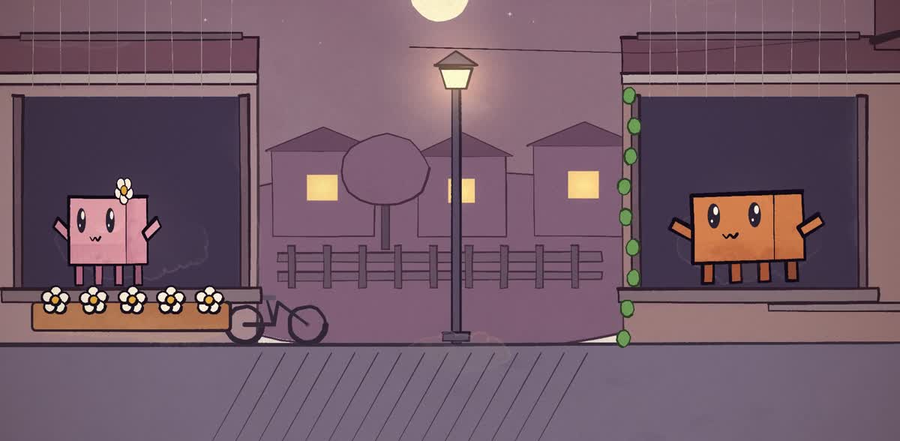

# 《爱你》：两扇窗之间的手绘 MV

这是使用 music-mv 工作流在 Claude Code 中完成的实际作品，画面由 Opus 编写代码并逐帧渲染。输入包括一张双角色参考图、王心凌《爱你》的本地音频和 LRC。

故事发生在一条小巷。粉色角色从一扇窗向另一扇窗传递心意：一个喷嚏、一通电话、纸飞机和小石子。橙色角色最后拿出一个盒子，里面收着她送过的东西。她把头上的花送给了他。

画面采用纸张纹理、水彩色块、墨线轮廓、有限动画和晨昏光线变化。风格参考“小镇姑娘”的手绘视觉语法，人物动作和故事依据《爱你》重新编排。

## 实际交付

| 项目 | 本次结果 |
|---|---|
| 主片 | 源歌曲 39–88 秒，共 49 秒 |
| 展示版 | 主片加约 4.5 秒结尾彩蛋，文件约 53.52 秒 |
| 画面 | 1920×1080、24fps、H.264 |
| 音轨 | AAC |
| 字幕 | LRC 行级同步，行内填色为估计 |
| 画面渲染 | p5.js + p5.brush、无头 Chrome、ffmpeg |

展示版的末尾经过追加彩蛋和音频渐弱处理，因此不能用主片文件名“39–88 秒”推断完整文件时长。仓库预览只抽取画面片段、无音轨，并裁掉歌词带。

这不是一条命令在几秒内直接生成的在线视频。Claude 会编写场景代码，渲染需要时间，效果也取决于角色复杂度、分镜和机器条件。

## 复现思路

1. 自备已获授权的角色图、歌曲与 LRC。
2. 用 /music-mv 提供五项输入：角色、歌曲、歌词、截取区间、风格。
3. 让角色演出歌词里的动作和情绪；给全片设一个能延续的世界和道具。
4. 同一个正式工程中检查代表帧，再渲染完整视频。

歌曲、LRC 和完整带音乐成片不作为仓库安装包的一部分。你可以用自己的素材做另一首歌、另一位角色的故事。
